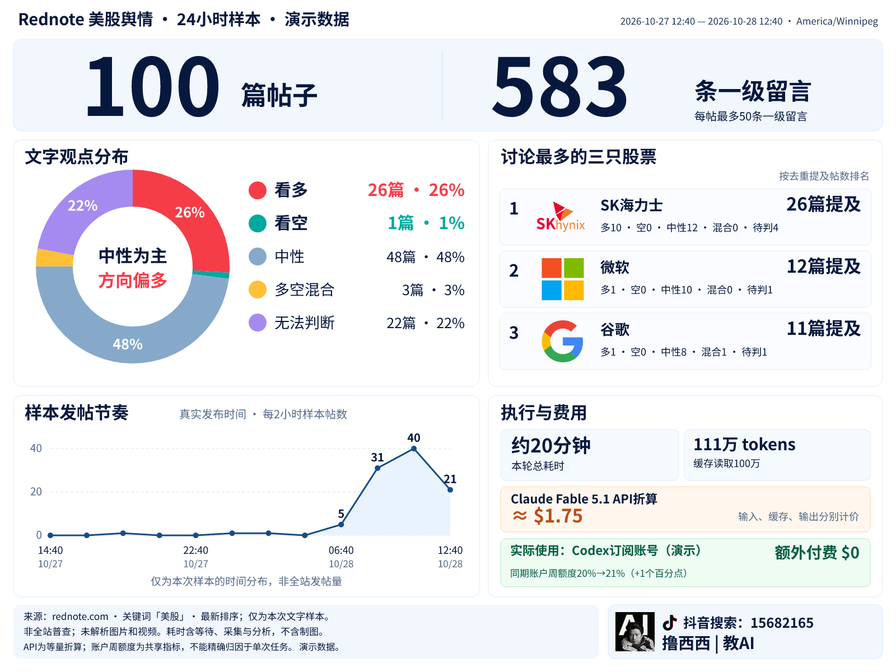

# Rednote US-stock sentiment Skill

[中文](README.md) · [Upstream reuse and our changes](references/PROVENANCE.md) · [Data schema](references/SCHEMA.md)

Collect a bounded 24-hour keyword sample from a logged-in Rednote browser, preserve raw evidence first, review the text, and render the same **4:3** report every time. Defaults: at most 100 posts and 50 first-level comments per post, serial browser operations.



The visual hierarchy emphasizes actual post count, actual first-level comment count, and the data-derived sentiment conclusion. The donut, publication-time line chart and top three stock rows use fixed coordinates, colors and bundled fonts. Every output includes the original creator avatar, Douyin symbol, **抖音搜索：15682165**, and **撸西西 | 教AI** in the bottom-right corner. The distributed renderer has no hide-brand flag.

## Install and run

Requires Node.js ≥20.18.1. Place the complete repository in your agent's skills directory, for example `~/.codex/skills/rednote-us-stock-sentiment-skill`, then run:

```bash
npm ci --ignore-scripts
npm run demo
npm test
```

Ignoring installation scripts prevents OpenCLI's installation-time daemon/adapter update hooks. The browser is connected only when collection is requested. Rendering needs no generative-image API, Python installation or system fonts.

Example agent request:

> Use $rednote-us-stock-sentiment-skill to collect a 24-hour US-stock discussion sample from Rednote, at most 100 posts and 50 first-level comments per post. Save raw data before analysis and render the fixed branded report.

Install the official [OpenCLI browser extension](https://github.com/jackwener/OpenCLI), personally approve its permissions, and log in to `rednote.com`. The package neither logs in for you nor reads/exports cookies. See [Collection](references/COLLECTION.md) for staged commands and stop/resume behavior.

To render an existing report:

```bash
node scripts/render.mjs --input examples/report.json --output output/report
```

Outputs: PNG, SVG, and a manifest. With the same runtime environment, software version, bundled fonts and input, repeated PNG/SVG bytes are identical. Share the PNG; opening the editable SVG separately requires the bundled font family. Missing metrics remain unknown instead of becoming zero.

## Counting and cost semantics

- The window applies to actual post publication time. Comments are visible snapshots taken during collection; they need not have been written in that window.
- Sentiment uses title/body text only. Unread image/video opinions and insufficient text remain unknown. Historical price changes or P/L emotions alone are not forecasts.
- Rank individual stocks by distinct mentioning posts; deduplicate repeated mentions within a post, exclude indices/ETFs, merge GOOG/GOOGL, and break equal-post ties by ticker.
- The line is this sample's two-hour publication distribution, not platform-wide volume, sentiment history or stock prices.
- The demo's 20 minutes, 1.11M tokens, $1.75 equivalent API estimate and quota values are illustrative, not an actual collection bill. API-equivalent estimates, subscription fees and extra charges are different quantities.
- Pricing is a dated official-source snapshot. Recheck it for new estimates. Account-wide quota changes cannot be attributed precisely to one task.

## What is reused, what is ours

**OpenCLI 2.0.2** supplies the browser bridge, search scroll builder, visible detail extraction and comment helpers. Its installed source is not patched. Our wrappers add real publication-time filtering, accumulation/deduplication, serial limits, visible native comment paging, append-only repair, raw hashing/freezing, evidence-backed annotations, schemas, cost accounting and the fixed branded SVG/PNG template.

[PROVENANCE.md](references/PROVENANCE.md) contains the bilingual file-level matrix, licenses, modifications and verification boundaries. Runtime dependencies include OpenCLI (Apache-2.0) and resvg-js (MPL-2.0); fonts use OFL-1.1 and the Simple Icons glyph uses CC0. fontTools is an authoring-only font-build tool. Our code is Apache-2.0. Company marks and creator identity assets retain their own notices; they are not claimed as original software artwork.

The predecessor adapter completed one real overseas-site run of 100 posts/583 first-level comments using OpenCLI 2.0.2, extension 1.0.26 and Ego Lite. Packaging performed offline regression and template checks, without another live scrape. The portable release has not been live-tested on every OS or a fresh account. Platform DOM or internal OpenCLI export changes require revalidation.

## Sources / Pre-Action Check

The commands above install local dependencies, run synthetic tests and render a demo; they do not access Rednote. They follow this repository's package/scripts and the checked official [OpenCLI](https://github.com/jackwener/OpenCLI) and [resvg-js](https://github.com/thx/resvg-js) documentation. Collection stops for login, rate/security blocks or hidden native-scroll pages. Versions/hashes are in the lockfile and asset manifests.
